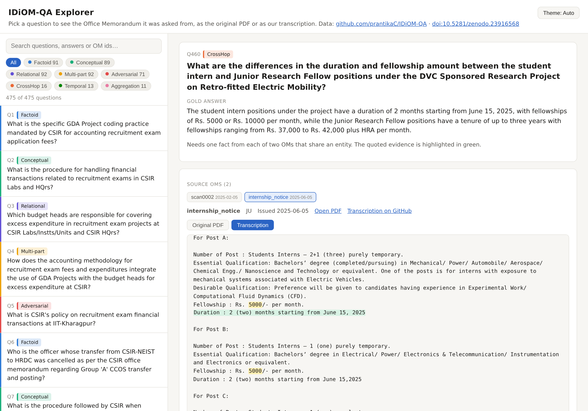

# IDiOM-QA

Question-answering benchmark over 116 Office Memoranda (OMs) and related notices
from four Indian academic and research bodies (UGC, CSIR, IACS, Jadavpur University),
with the IDiOM-RAG reference system and the outputs of twelve RAG systems.

[](https://doi.org/10.5281/zenodo.23916568)

## Browse the benchmark: [IDiOM-QA Explorer](https://prantikac.github.io/IDiOM-QA/)

**[prantikac.github.io/IDiOM-QA](https://prantikac.github.io/IDiOM-QA/)**. Pick any of the 475 questions
to see its gold answer and the Office Memorandum it was asked from, as the original PDF or as our
transcription, with the evidence highlighted. Filter by question type or search by text or OM id.

[](https://prantikac.github.io/IDiOM-QA/)

## Contents
- `data/qa/idiom_qa_v4_paper.json`: the 475 QA pairs scored in the paper (91 Factoid, 89 Conceptual,
  92 Relational, 92 Multi-part, 71 Adversarial, 16 CrossHop, 13 Temporal, 11 Aggregation).
  Each item has `input`, `expected_output`, `question_type`, `source` (OM id) and
  `context_used` (gold evidence); CrossHop items also carry the two OMs and their evidence.
- `data/corpus/<body>/<body>_om_text_files/`: hand-checked VLM transcriptions of all 116 OMs
  (YAML frontmatter with `issue_date`); `<body>_oms_summary/` holds one-paragraph summaries.
- `data/kg/kg.json`: the typed knowledge graph (397 entities, 105 Document nodes, 591 triples;
  every triple carries `source_om` and `issue_date`).
- `data/qrels/`: TREC-format OM-level relevance judgements for the 404 answerable questions, with `queries.tsv` and `docids.tsv`.
- `results/`: per-question outputs and scores of the twelve RAG systems and the two reference
  runs (closed book, gold evidence) on `idiom_qa_v4_paper.json`:
  - `ragas/`: six RAGAS metrics (judge deepseek-r1:32b); each detailed CSV also holds the
    question, response, retrieved contexts and gold answer;
  - `surface/`: ROUGE, BLEU, METEOR, BERTScore;
  - `hhem/` and `factcheck/` (AlignScore, MiniCheck): context-answer support;
  - `retrieval/`: retriever runs and qrels-based metrics.
  Every number and figure in the paper is computed from these files.
- `docs/`: the IDiOM-QA Explorer web page (https://prantikac.github.io/IDiOM-QA/), which shows each
  question with its source OM as the original PDF (`docs/pdfs/`) and as our transcription.
- `code/`: IDiOM-RAG (`src/`), the eleven baselines (`baselines/`), index and KG builders,
  the question generator and the evaluation scripts (`scripts/`).

## Running IDiOM-RAG

**Neo4j is required to reproduce IDiOM-RAG as reported in the paper.** Its KG retriever
turns each sub-task into a Cypher query over the knowledge graph in `data/kg/kg.json`, served
by a running Neo4j database. Without Neo4j the system still runs, but the KG retriever is
switched off (the log shows `Failed to connect to Neo4j`) and only dense and BM25 retrieval
remain, so its answers and scores will differ from the paper. Among the baselines only GEAR
needs Neo4j: its triple linking queries the same graph.

We used Neo4j 2026.01 (Enterprise); Community Edition also works, since IDiOM-RAG needs only
one database. Any 5.x or later release with Bolt access should do.

    # 1. Neo4j: install it, or run it in Docker
    docker run -d --name idiom-neo4j -p 7474:7474 -p 7687:7687 \
        -e NEO4J_AUTH=neo4j/<password> neo4j:latest
    export NEO4J_URI=neo4j://127.0.0.1:7687 NEO4J_USERNAME=neo4j NEO4J_PASSWORD=<password>
    # optional: NEO4J_DATABASE (default "neo4j")

    # 2. Python environment, retrieval indices and the knowledge graph
    cd code && pip install -r requirements.txt
    python scripts/build_indices.py --text-root ../data/corpus
    python scripts/load_kg.py --kg ../data/kg/kg.json    # 502 nodes, 591 relations; --wipe to replace

    # 3. Local models via Ollama: qwen2.5:7b (generation), qwen2.5:32b (reasoning)
    python scripts/run_idiom_rag.py --backend ollama --dataset ../data/qa/idiom_qa_v4_paper.json

`load_kg.py` loads the released graph exactly as it was used in the paper, and refuses to write
into a database that already holds nodes unless `--wipe` is given. `scripts/build_kg.py`
rebuilds a graph from the transcriptions with an LLM instead, which will not give the same graph.

For every question the output also lists `source_oms`, the OMs IDiOM-RAG found its answer in
(per resolved sub-task: the kept chunk that best matches the accepted fact, plus the OM of any
amount in the fact that this chunk does not contain), and `subtask_sources`, which gives each
sub-task's fact, its source OMs and all OMs in its context.
Refused or unresolved questions have no source OM. Attribution does not change the answers.

Scoring: `scripts/evaluate_ragas_metrics.py` (RAGAS, judge deepseek-r1:32b via Ollama).
All hyperparameters are in `code/config.py`.

## Licence
- **Code** (`code/`): MIT, see `LICENSE`.
- **Data and results** (`data/`, `results/`): Creative Commons Attribution 4.0 International
  (CC-BY-4.0), see `LICENSE-DATA`, `data/LICENSE` and `results/LICENSE`.

The OM texts in `data/corpus/` and the original PDFs in `docs/pdfs/` reproduce public documents
issued by UGC, CSIR, IACS and Jadavpur University. CC-BY-4.0 applies to our
own contributions: the questions and gold answers, the corrections to the transcriptions, the
document summaries, the knowledge graph, the relevance judgements and the system results.

## Citation
If you use IDiOM-QA, please cite:

```bibtex
@dataset{chakraborty2026idiomqa,
  author    = {Chakraborty, Prantika and Adhikary, Subham and Adhya, Suman and Sanyal, Debarshi Kumar},
  title     = {{IDiOM-QA}: A Dataset for Question Answering on Office Memoranda for Indian Research and Educational Institutions},
  year      = {2026},
  publisher = {Zenodo},
  doi       = {10.5281/zenodo.23916568},
  url       = {https://doi.org/10.5281/zenodo.23916568}
}
```
